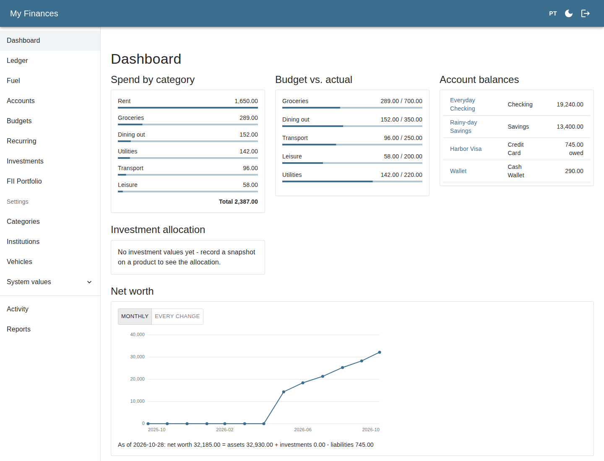

# My Finances

[](https://github.com/hmcaio/my-finances/actions/workflows/ci.yml)
[](https://github.com/hmcaio/my-finances/releases/latest)
[](LICENSE)

A personal finance manager, built for exactly one user, running on exactly one trusted machine, with no cloud, one shared login instead of accounts, and no ambiguity about who owns the data. It tracks transactions across named accounts (checking, savings, credit card, cash), enforces monthly category budgets, and computes net worth as assets + investments − credit card balances, with the accounting done properly: a credit card purchase increases what you owe, and paying the statement is a transfer between accounts rather than a second expense, so spend and debt never double-count.

Manual entry only. There's no bank sync, because there's no server to sync to: the app runs on-demand on your own machine and shuts down when you're not using it.



**Contents**

- [Why it's built this way](#why-its-built-this-way)
- [Quick start (development)](#quick-start-development)
- [Running a release](#running-a-release)
- [Tech stack](#tech-stack)
- [Architecture](#architecture)
- [Documentation](#documentation)
- [Repository layout](#repository-layout)
- [Project status](#project-status)
- [Contributing](#contributing)
- [License](#license)

## Why it's built this way

Most personal finance tools are either a spreadsheet you maintain by hand, or a hosted SaaS that wants your bank credentials and your data on someone else's server. This is neither: a small, self-hosted app that runs when you tell it to and keeps everything local, with none of the multi-tenant machinery a "real" SaaS would need.

Every non-obvious decision behind that shape is written down as an [ADR](docs/adr/) rather than left implicit, and the full product spec (data model, versioning rules, net worth formula, non-goals) lives in [docs/PRD.md](docs/PRD.md). Both are meant to be read, not just archived; this README is the short version.

## Quick start (development)

Local dev needs only Docker. The default is to run everything in containers with hot reload, so the toolchain versions are the pinned ones CI and production use.

1. `cp .env.example .env`, then set `TZ` to your own time zone (so the API's "today" matches your browser's) and the login credential: `AUTH_USERNAME` plus `AUTH_PASSWORD_HASH`, generated as described in [Login](docs/operations.md#login). Keep the hash **single-quoted**.
2. Start the stack:

   ```bash
   docker compose --profile full up -d   # Postgres, pgAdmin (localhost:5050), API (localhost:8080), UI (localhost:5173)
   docker compose --profile full down
   ```

3. Open `http://localhost:5173` and sign in. The first start downloads Gradle and npm dependencies (a couple of minutes). The API's Swagger UI is at `http://localhost:8080/swagger-ui.html` (dev only, and it needs a session; see [docs/conventions/auth.md](docs/conventions/auth.md)).

To run the apps natively instead (fastest loop, IDE debugging) you need a JDK 25 and the Node version in `frontend/.nvmrc` (`npm` refuses another major), and you must not run the `full` profile at the same time: both use ports 8080 and 5173. See [backend/CLAUDE.md](backend/CLAUDE.md) and [frontend/CLAUDE.md](frontend/CLAUDE.md) for the exact commands (build, lint, test, run). The short version:

```bash
docker compose up -d      # start local Postgres only (+ pgAdmin at localhost:5050)
cd backend && ./gradlew bootRun    # API at localhost:8080 (export AUTH_USERNAME / AUTH_PASSWORD_HASH in this shell first)
cd frontend && npm install && npm run dev  # UI at localhost:5173
```

## Running a release

To run a published release rather than develop on it you need only Docker with Compose: no checkout, no JDK. The prod stack (Postgres, backend, frontend, encrypted-backup sidecar) pulls images by tag from GHCR, and images exist only for release tags (`vX.Y.Z`; `latest` is the newest stable release). Everything an operator needs is in [docs/operations.md](docs/operations.md):

- [Running the published images](docs/operations.md#running-the-published-images-production) and [Upgrading](docs/operations.md#upgrading) (including rolling back)
- [Login](docs/operations.md#login): generating the credential, sessions, rate limiting
- [Reaching the app from other devices](docs/operations.md#reaching-the-app-from-other-devices): `BIND_ADDR`, and why TLS is yours to add
- [Backups](docs/operations.md#backups): setup, taking one now, restoring

## Tech stack

- **Backend**: Java + Spring Boot, built with Gradle. PostgreSQL via Flyway migrations. OpenAPI/Swagger UI generated from the controllers.
- **Frontend**: React + TypeScript, built with Vite. Material UI (with a dark-mode toggle), React Router, TanStack Query for every read/write ([ADR 0016](docs/adr/0016-tanstack-query-client-cache.md)), Axios through one centralized client.
- **Testing**: JUnit + Testcontainers on the backend (every run gets a real, ephemeral Postgres). Vitest + React Testing Library + MSW on the frontend, Playwright for layout checks.
- **Infra**: Docker Compose for local dev and a separate file for a production-shaped deployment. GitHub Actions runs the tests on every pull request and on `main`, and builds, scans and publishes the images on release tags only.

## Architecture

Hexagonal Architecture, Domain-Driven Design and test-first for the rules-heavy logic (net worth, versioning, recurring catch-up). Start at [docs/conventions/backend-structure.md](docs/conventions/backend-structure.md) for the package layout, [docs/PRD.md](docs/PRD.md) §5/§7.2 for the data model and aggregates, and [docs/adr/](docs/adr/) for the reasoning behind each non-obvious call.

## Documentation

| Where | What |
|---|---|
| [docs/PRD.md](docs/PRD.md) | Product spec: data model, functional requirements, non-goals |
| [docs/adr/](docs/adr/README.md) | Architectural Decision Records |
| [docs/features/](docs/features/README.md) | One `spec.md` + `plan.md` per feature, in build order |
| [docs/conventions/](docs/conventions/README.md) | Area mechanics (errors, auth, logging, data constraints, tooling, release, backend and frontend structure) |
| [docs/operations.md](docs/operations.md) | Running, upgrading and backing up the published images |
| [CHANGELOG.md](CHANGELOG.md) | What each release contains, with `Upgrade:` notes |
| [CODING_STANDARDS.md](CODING_STANDARDS.md) | Review-time judgement rules |

## Repository layout

```
backend/                  Spring Boot API (domain / application / infrastructure)
frontend/                 React + TypeScript SPA
backup/                   Encrypted pg_dump sidecar image for the prod stack (F018)
scripts/                  verify.sh (what CI runs), check-versions.sh, smoke-prod.sh (prod-stack smoke test),
                          setup-hooks.sh (pre-commit), apply-rulesets.sh, plus helpers for the e2e driver and the image scan
docs/                     PRD.md, operations.md, features/, adr/, conventions/
docker-compose.yml        Local dev: Postgres + pgAdmin (+ backend and frontend under --profile full)
docker-compose.prod.yml   Production-shaped stack: Postgres + backend + frontend + backup
.env.example              Every environment variable, with placeholders; copy to .env
.github/workflows/        CI (tests on PRs and main) and CD (image publish on release tags only)
CHANGELOG.md              Release notes, one shared version for backend and frontend
CLAUDE.md                 Working guidance for AI coding agents (cross-stack; backend/, frontend/ each have their own)
```

## Project status

Which features are built and which are documented but deferred is the "Status" list in [docs/features/README.md](docs/features/README.md#status), with each feature's spec and plan behind its row. What each release contains, and what is still unreleased, is in the [CHANGELOG](CHANGELOG.md); the published versions are on the [GitHub Releases page](https://github.com/hmcaio/my-finances/releases).

## Contributing

Solo project, but run with real process because that's what keeps a project like this coherent over time rather than because a team requires it: [GitHub Flow on `main` only](docs/adr/0032-github-flow-main-only.md) (short-lived branches squash-merged into `main`), [Conventional Commits](docs/adr/0009-conventional-commits.md), and a [single shared SemVer version](docs/adr/0007-single-shared-semver-and-changelog.md) for backend and frontend together, tracked in [`CHANGELOG.md`](CHANGELOG.md). There is no `develop` branch and no promotion step: every change is a PR into `main`, and a release is a `chore/release-vX.Y.Z` PR (CHANGELOG and version bump) squash-merged into `main`, followed by a `vX.Y.Z` tag on that squash commit, which is what publishes the images and moves `latest`. The steps are in [docs/conventions/release.md](docs/conventions/release.md).

- **One-time setup**: run `scripts/setup-hooks.sh` to enable the local pre-commit hook, which runs Spotless (backend) and Prettier + ESLint (frontend) on the stacks a commit touches, so formatting slips fail at commit time instead of in CI. It sets the repo-wide `core.hooksPath` (shared by all worktrees); `--uninstall` undoes it.
- **Before pushing**: `scripts/verify.sh` runs the same checks CI does (pinned versions, backend spotless + tests, frontend lint, format, build, tests). It needs Docker running and `npm ci` done in `frontend/`.
- **Production-shaped smoke test** (Docker images end to end, no cloud involved): [docs/conventions/tooling.md](docs/conventions/tooling.md).

## License

MIT — see [LICENSE](LICENSE).
